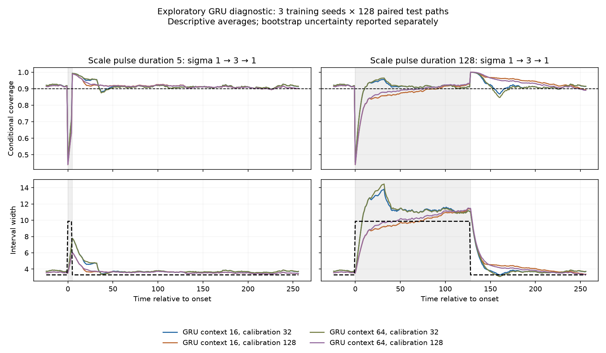

# Neural Memory and Interval Calibration

DSAA 2012 Deep Learning 课程项目的第一阶段研究。问题是：**神经预测器的尺度响应如何改变在线校准在波动冲击进入、退出时的效果？**只使用公开 ECB 汇率与自生成模拟数据。

先导已可复现，但尚未证明 A+ 级别的原创贡献。GRU 与手工摘要 MLP 的模拟结果方向不同；公开汇率上 GRU 没有清楚胜过 EWMA。所有正、负结果保留，不预设长上下文有害或神经模型一定占优。

## 从这里开始

- [一页 proposal 草稿](output/pdf/project_proposal.pdf) · [LaTeX 源码与官方模板](proposal/)
- [第一阶段结论与 A+ 差距](research/feasibility_report.md)
- [下一阶段实验关卡与时间安排](research/next_experiments.md)
- [课程要求映射](research/course_requirements.md)
- [文献与原创性边界](research/literature_gap.md)
- [公开数据核查](research/public_data_feasibility.md) · [实验审查](research/experiment_design_audit.md)
- [作者源码强基线说明](research/strong_baseline_notes.md) · [HPC 交接](research/hpc_runbook.md)

## 已运行的实验

| 脚本 | 目的 | 输出 |
|---|---|---|
| `scripts/run_pilot.py` | 手工摘要 MLP 的配对模拟诊断 | `outputs/pilot/` |
| `scripts/run_gru_simulation.py` | 真正的 GRU，3 种子×128 共享路径，context×calibration | `outputs/gru_simulation/` |
| `scripts/run_archive_intervention.py` | 独立改变当前尺度与归档分母，诊断归因 | `outputs/archive_intervention/` |
| `scripts/run_public_fx_pilot.py` | ECB 公开数据上的从头训练 GRU 与 EWMA | `outputs/public_fx/` |
| `scripts/run_strong_calibration.py` | 固定作者源码 SF-OGD/SAOCP，复用 issued 预测 | `outputs/strong_calibration/` |
| `scripts/analyze_public_fx.py` | 配对日期块统计，保留跨资产依赖 | `outputs/public_fx/` |

每个实验目录包含运行设置、source/checkpoint hash 与限制说明。大逐行 CSV 以 `.csv.gz` 保存到 Git，展开后与原始 CSV 字节一致。运行脚本会生成原 CSV；分析脚本支持两种格式。




## 本地复现

本次环境为 Python 3.12.14、Torch 2.14.1；完整版本见 `requirements-lock.txt`。这些先导在 CPU 上以四线程运行，每个训练脚本约 20 秒，不需要先接入 HPC。

```bash
uv venv --python 3.12 .venv
uv pip install --python .venv/bin/python -r requirements-lock.txt
.venv/bin/python scripts/run_pilot.py
.venv/bin/python scripts/run_gru_simulation.py
.venv/bin/python scripts/run_archive_intervention.py
.venv/bin/python scripts/run_public_fx_pilot.py
.venv/bin/python scripts/run_strong_calibration.py
.venv/bin/python scripts/analyze_public_fx.py
.venv/bin/python scripts/verify_artifacts.py
```

不同硬件/库版本可能产生小的数值差异；冻结数据 archive 可避免重新下载时历史区间变动。SF-OGD/SAOCP 使用作者源码的明确适配，原始 Apache-2.0 许可与版权头保留，详见其输出目录的 `vendor/`。未改变算法的更新或专家聚合。

## 解释与使用边界

区间目标是 90% 覆盖，指标同时报告宽度和区间分数。模拟真尺度只用于评估/诊断，算法输入不含未来持续时间或事件标签。真实数据的 2021–2026 段已经用于探索，不能再称盲测。日期块区间条件于已拟合模型，不能自动证明任意漂移下有效。

本项目不读取、复制或使用微众比赛数据、派生特征、样本、结果，也不保存 HPC 凭据。ECB 数据来源、单位与许可说明见 [data/public/README.md](data/public/README.md)。课程要求个人独立完成；proposal 为学生审核修改的草稿，工具使用须符合课程政策。
