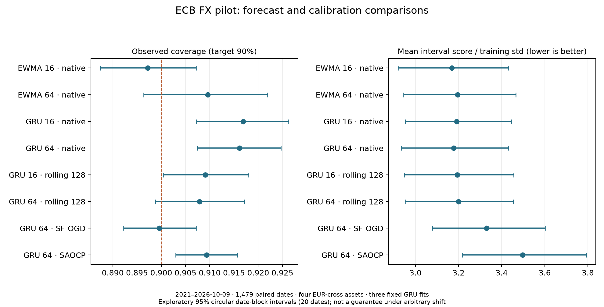

# Neural Memory and Interval Calibration

DSAA 2012 Deep Learning 课程项目。问题是：**神经预测器的尺度响应如何改变在线校准在波动冲击进入、退出时的效果？**只使用公开 ECB 汇率与自生成模拟数据。

最新完成 Stage3：3批独立训练/验证数据、每批5对 GRU/TCN 种子，共30个新拟合，评估全部4组新测试。Gaussian D128 A3 的 entry 架构交互差在三个面板均为负，但跨训练面板/共享种子的敏感性区间包含0；recovery 的旧正向差异没有得到稳健重复。同一 Gaussian entry 条件下，TCN current 分量的种子标准差在6/6个面板×分解路线组合大于 GRU current，但只有4/6大于自身 archive；这些组合相关，不能称六次独立检验或普遍的 current 主导。

第一、二阶段完整保留为历史探索与已完成验证：公开汇率上的 GRU 没有清楚胜过 EWMA，Stage2 架构比较对初始化敏感。**目前不能声称稳定架构优势、已经验证的新方法或 A+ 保证**。当前主线是解释不同记忆通道的阶段性组合和适用边界。

## 从这里开始

- [回来后先读这里：最新结论、A+缺口与60分钟阅读安排](research/current_status_zh.md)

- [一页 proposal 草稿](output/pdf/project_proposal.pdf) · [LaTeX 源码与官方模板](proposal/)
- [四页报告工作稿 PDF（草稿）](output/pdf/working_report.pdf) · [工作稿 LaTeX 源码](report/working_report.tex)；供学生理解和修订，尚未提交。
- [第三阶段新复制的实际结果](research/stage3_results.md) · [冻结协议](configs/stage3_replication_protocol.json) · [复现入口](research/stage3_runbook.md)
- [第二阶段实际结论与完整网格](research/stage2_results.md)
- [当前尺度与历史档案的交叉机制诊断](research/stage2_archive_mechanism.md)
- [评分曲率的基础解释与oracle诊断](research/score_geometry.md) · [直接先例与贡献审查](research/contribution_review.md)
- [中文项目解释：如何讲清楚设计与统计量](research/project_explainer_zh.md)
- [第二阶段冻结协议](research/stage2_protocol.md) · [训练核查](research/stage2_training_notes.md) · [验证记忆诊断](research/stage2_memory_notes.md) · [复现入口](research/stage2_runbook.md)
- [第一阶段结论与 A+ 差距](research/feasibility_report.md)
- [下一阶段实验关卡与时间安排](research/next_experiments.md)
- [课程要求映射](research/course_requirements.md)
- [文献与原创性边界](research/literature_gap.md)
- [公开数据核查](research/public_data_feasibility.md) · [实验审查](research/experiment_design_audit.md)
- [作者源码强基线说明](research/strong_baseline_notes.md) · [HPC 交接](research/hpc_runbook.md)

## 已运行的实验

| 脚本 | 目的 | 输出 |
|---|---|---|
| `scripts/run_pilot.py` | 手工摘要 MLP 的配对模拟诊断 | `outputs/pilot/` |
| `scripts/run_gru_simulation.py` | 真正的 GRU，3 种子×128 共享路径，context×calibration | `outputs/gru_simulation/` |
| `scripts/run_archive_intervention.py` | 独立改变当前尺度与归档分母，诊断归因 | `outputs/archive_intervention/` |
| `scripts/run_public_fx_pilot.py` | ECB 公开数据上的从头训练 GRU 与 EWMA | `outputs/public_fx/` |
| `scripts/run_strong_calibration.py` | 固定作者源码 SF-OGD/SAOCP，复用 issued 预测 | `outputs/strong_calibration/` |
| `scripts/analyze_public_fx.py` | 配对日期块统计，保留跨资产依赖 | `outputs/public_fx/` |
| `scripts/train_stage2.py` | 同数据/特征/批次、验证早停，10个GRU/TCN拟合 | `outputs/stage2_training/` |
| `scripts/stage2_baselines.py` | 训练集拟合GARCH、固定EWMA与校准参数 | `outputs/stage2_controls/` |
| `scripts/stage2_memory_diagnostics.py` | 仅验证集梯度/旧历史置换诊断 | `outputs/stage2_memory/` |
| `scripts/evaluate_stage2.py` | 冻结30情景，配对反事实与有限记忆检查 | `outputs/stage2_evaluation/` |
| `scripts/analyze_stage2.py` | 两项主比较与全部描述性网格，不重训 | `outputs/stage2_analysis/` |
| `scripts/stage2_strong_supplement.py` | 引用组单种子ACI/SF-OGD/SAOCP在线对照 | `outputs/stage2_strong_supplement/` |
| `scripts/run_stage2_archive_diagnostic.py` | 全五种子current/archive交叉，明确探索范围 | `outputs/stage2_archive_mechanism/` |
| `scripts/train_stage3_repeats.py` | 3批独立训练/验证数据，全部30个新拟合 | `outputs/stage3_training/` |
| `scripts/stage3_response_probes.py` | 仅验证集的旧输入依赖与尺度响应探针 | `outputs/stage3_response_probes/` |
| `scripts/evaluate_stage3.py` | 新4情景、完整8格、两条分解路线与负控制 | `outputs/stage3_evaluation/` |
| `scripts/analyze_stage3.py` | 固定15对拟合的路径统计及面板/种子敏感性 | `outputs/stage3_analysis/` |

各阶段用 metadata/manifest 记录运行设置、source/checkpoint hash 与限制。第一阶段的大逐行 CSV 以 `.csv.gz` 归档，其分析支持原始与压缩两种格式；第二、三阶段的逐 path 表直接写入 `.csv.gz`。

第三阶段的[重复协议](configs/stage3_replication_protocol.json)与[验证响应探针](configs/stage3_response_probes.json)在新测试访问前冻结，属于 Stage2 启发的独立复制。259项保存结果核查已通过，包含协议、checkpoint、训练批次、配对索引、全部输出哈希、分解与统计检查；它们不构成覆盖保证或新算法的性能证明。




## 本地复现

本次环境为 Python 3.12.14、Torch 2.14.1；完整版本见 `requirements-lock.txt`。第一阶段训练每个脚本约20秒；第二阶段10模型训练约302秒、主评估约1032秒、强控制器补充约444秒；第三阶段30模型训练935.88秒、验证探针63.73秒、评估598.53秒、分析3.82秒，均在本地CPU完成。保存结果可直接核查；从头重跑须先备份已有输出，顺序见 [Stage2](research/stage2_runbook.md) 与 [Stage3](research/stage3_runbook.md) 复现入口。

```bash
uv venv --python 3.12 .venv
uv pip install --python .venv/bin/python -r requirements-lock.txt
.venv/bin/python scripts/run_pilot.py
.venv/bin/python scripts/run_gru_simulation.py
.venv/bin/python scripts/run_archive_intervention.py
.venv/bin/python scripts/run_public_fx_pilot.py
.venv/bin/python scripts/run_strong_calibration.py
.venv/bin/python scripts/analyze_public_fx.py
.venv/bin/python scripts/verify_artifacts.py
.venv/bin/python scripts/verify_stage2_artifacts.py
.venv/bin/python scripts/verify_stage3_artifacts.py
```

不同硬件/库版本可能产生小的数值差异；冻结数据 archive 可避免重新下载时历史区间变动。SF-OGD/SAOCP 使用作者源码的明确适配，原始 Apache-2.0 许可与版权头保留，详见其输出目录的 `vendor/`。未改变算法的更新或专家聚合。

## 解释与使用边界

区间目标是 90% 覆盖，指标同时报告宽度和区间分数。模拟真尺度只用于评估/诊断，算法输入不含未来持续时间或事件标签。真实数据的 2021–2026 段已经用于探索，不能再称盲测。日期块区间条件于已拟合模型，不能自动证明任意漂移下有效。

本项目不读取、复制或使用微众比赛数据、派生特征、样本、结果，也不保存 HPC 凭据。ECB 数据来源、单位与许可说明见 [data/public/README.md](data/public/README.md)。学生于 2026-10-11 确认课程允许 AI 工具；学生仍承担个人作者责任，并须理解全部假设、代码与结果。Proposal 与报告工作稿均未提交：proposal 截止10月16日23:59，报告、PDF slides与8–10分钟视频截止12月11日23:59；具体格式见 [课程要求](research/course_requirements.md)。下一步先收敛机制叙事、修订草稿并获取学生反馈，再决定是否需要新实验。
