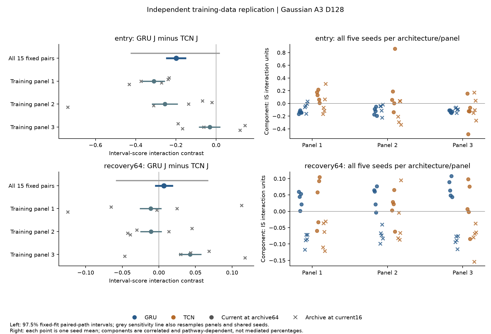
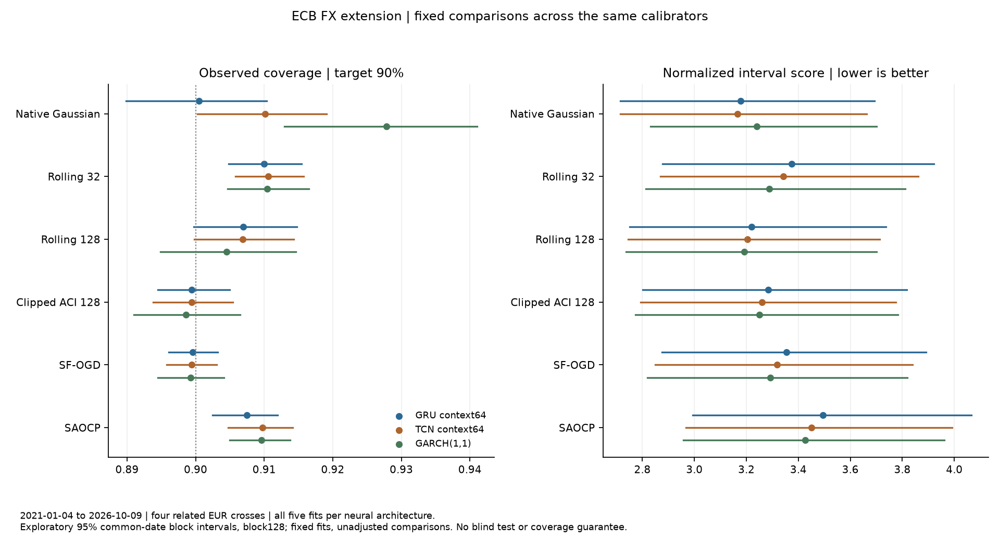

# Neural Memory and Interval Calibration

DSAA 2012 Deep Learning 课程项目。问题是：**神经预测器的尺度响应如何改变在线校准在波动冲击进入、退出时的效果？**只使用公开 ECB 汇率与自生成模拟数据。

更新于2026-10-18。已完成三份独立训练数据的神经重复、全部30个冻结模型的分位数秩敏感性，以及10个新拟合的公开FX扩展。Gaussian entry交互在三份训练数据中保持负的均值方向，但重训敏感性仍跨0；recovery的旧正向差异没有稳定重复。共同理想秩水平的检查保留主要Gaussian方向，也显示部分小效应对规则敏感。

FX扩展保留全部五对GRU/TCN拟合、四币种、经典基线与六种区间规则：native神经模型的pooled mean IS低于GARCH，但五种在线校准器下的均值排序均反转，币种与区间读数也有差异。这个已看历史的探索不建立通用神经优势。新增过去固定倍率控制未消除池化点估计反转，但GRU优势依赖CHF，不能据此认定普遍动态机制。

**当前优先级：研究本身，暂停报告和PPT制作。** 有限样本8项主对照通过，12个新神经拟合主条件的风险解释误差由0.1184降到0.0341。长窗口上涨初期的例外已进一步拆解：总体近似的时间误差抵消改变排名，同批创新交叉后差距缩小，补充区间包含0；尚不能认定稳定失效。下一轮已固定16批新路径验证，尚未运行。71%的改善指解释误差降低，不是模型性能提升；尚无原创性或录用结论。[研究路线与Dec.11安排](research/research_direction_2026_10_18.md)

学校HPC独立环境已完成A40上的GRU/TCN运算验证，并在Linux通过已有三个阶段的441项保存结果核查。全部HPC作业使用免费debug；新科学实验在本地CPU完成。学校现行政策由教师统一结算学生账户费用，课程具体额度仍未核实。[HPC入口、记录与费用依据](research/hpc_runbook.md)

## 从这里开始

- [最新研究决定与关卡](research/research_direction_2026_10_18.md) · [直接近邻文献](research/compatibility_literature_review.md)
- [固定过去倍率检查](research/fx_static_scale_results.md) · [尺度误差传递的数学可行性](research/compatibility_math_review.md)
- [有限样本机制验证：8项主对照与失败边界](research/finite_mechanism_results.md) · [冻结设计](research/finite_mechanism_protocol.md)
- [12个新拟合的神经机制结果](research/neural_compatibility_results.md) · [定义与复现](research/neural_compatibility_runbook.md)
- [长窗口为何出现例外：精确风险、时间抵消与共享样本](research/long_window_diagnosis.md) · [下一轮16批新路径方案（未运行）](research/long_window_validation_protocol.md)
- [回来后先读这里：最新结论、A+缺口与60分钟阅读安排](research/current_status_zh.md)

- [Proposal 提交版：一页正文＋附录](output/pdf/DSAA2012_Proposal_Chengxuan_YUAN_50025581.pdf) · [LaTeX 源码与官方模板](proposal/)
- [四页报告工作稿 PDF（草稿）](output/pdf/working_report.pdf) · [工作稿 LaTeX 源码](report/working_report.tex)；供学生理解和修订，尚未提交。
- [全部30模型的秩敏感性结果](research/rank_sensitivity_results.md) · [理解与复现](research/rank_sensitivity_runbook.md)
- [10拟合公开FX扩展](research/fx_extension_results.md) · [冻结协议](research/fx_extension_protocol.md)
- [第三阶段新复制的实际结果](research/stage3_results.md) · [冻结协议](configs/stage3_replication_protocol.json) · [复现入口](research/stage3_runbook.md)
- [第二阶段实际结论与完整网格](research/stage2_results.md)
- [当前尺度与历史档案的交叉机制诊断](research/stage2_archive_mechanism.md)
- [评分曲率的基础解释与oracle诊断](research/score_geometry.md) · [直接先例与贡献审查](research/contribution_review.md)
- [中文项目解释：如何讲清楚设计与统计量](research/project_explainer_zh.md)
- [第二阶段冻结协议](research/stage2_protocol.md) · [训练核查](research/stage2_training_notes.md) · [验证记忆诊断](research/stage2_memory_notes.md) · [复现入口](research/stage2_runbook.md)
- [第一阶段结论与 A+ 差距](research/feasibility_report.md)
- [下一阶段实验关卡与时间安排](research/next_experiments.md)
- [课程要求映射](research/course_requirements.md)
- [文献与原创性边界](research/literature_gap.md)
- [公开数据核查](research/public_data_feasibility.md) · [实验审查](research/experiment_design_audit.md)
- [作者源码强基线说明](research/strong_baseline_notes.md) · [HPC 交接](research/hpc_runbook.md)

## 已运行的实验

| 脚本 | 目的 | 输出 |
|---|---|---|
| `scripts/run_pilot.py` | 手工摘要 MLP 的配对模拟诊断 | `outputs/pilot/` |
| `scripts/run_gru_simulation.py` | 真正的 GRU，3 种子×128 共享路径，context×calibration | `outputs/gru_simulation/` |
| `scripts/run_archive_intervention.py` | 独立改变当前尺度与归档分母，诊断归因 | `outputs/archive_intervention/` |
| `scripts/run_public_fx_pilot.py` | ECB 公开数据上的从头训练 GRU 与 EWMA | `outputs/public_fx/` |
| `scripts/run_strong_calibration.py` | 固定作者源码 SF-OGD/SAOCP，复用 issued 预测 | `outputs/strong_calibration/` |
| `scripts/analyze_public_fx.py` | 配对日期块统计，保留跨资产依赖 | `outputs/public_fx/` |
| `scripts/train_stage2.py` | 同数据/特征/批次、验证早停，10个GRU/TCN拟合 | `outputs/stage2_training/` |
| `scripts/stage2_baselines.py` | 训练集拟合GARCH、固定EWMA与校准参数 | `outputs/stage2_controls/` |
| `scripts/stage2_memory_diagnostics.py` | 仅验证集梯度/旧历史置换诊断 | `outputs/stage2_memory/` |
| `scripts/evaluate_stage2.py` | 冻结30情景，配对反事实与有限记忆检查 | `outputs/stage2_evaluation/` |
| `scripts/analyze_stage2.py` | 两项主比较与全部描述性网格，不重训 | `outputs/stage2_analysis/` |
| `scripts/stage2_strong_supplement.py` | 引用组单种子ACI/SF-OGD/SAOCP在线对照 | `outputs/stage2_strong_supplement/` |
| `scripts/run_stage2_archive_diagnostic.py` | 全五种子current/archive交叉，明确探索范围 | `outputs/stage2_archive_mechanism/` |
| `scripts/train_stage3_repeats.py` | 3批独立训练/验证数据，全部30个新拟合 | `outputs/stage3_training/` |
| `scripts/stage3_response_probes.py` | 仅验证集的旧输入依赖与尺度响应探针 | `outputs/stage3_response_probes/` |
| `scripts/evaluate_stage3.py` | 新4情景、完整8格、两条分解路线与负控制 | `outputs/stage3_evaluation/` |
| `scripts/analyze_stage3.py` | 固定15对拟合的路径统计及面板/种子敏感性 | `outputs/stage3_analysis/` |
| `scripts/run_rank_sensitivity.py` / `analyze_rank_sensitivity.py` | 全30模型共同理想秩水平的事后敏感性 | `outputs/rank_sensitivity/`、`outputs/rank_sensitivity_analysis/` |
| `scripts/run_fx_extension.py` / `analyze_fx_extension.py` | 10新拟合、四币种、完整经典/在线校准对照 | `outputs/fx_extension/`、`outputs/fx_extension_analysis/` |
| `scripts/analyze_fx_static_scale.py` | 2019/2020固定过去倍率，排查FX排名变化的简单解释 | `outputs/fx_static_scale/` |
| `scripts/check_compatibility_expansion.py` | 外生尺度误差的总体混合分位数展开；探索性数学检查 | `outputs/compatibility_math_probe/` |
| `scripts/run_finite_mechanism.py` / `verify_finite_mechanism.py` | 分开历史跨度、score数量与秩规则，验证8个主要时间排列对照 | `outputs/finite_mechanism/` |
| `scripts/train_neural_compatibility.py` / `evaluate_neural_compatibility.py` / `analyze_neural_compatibility.py` | 3批数据、12个新拟合，区分总体近似、实际历史与独立有限历史库 | `outputs/neural_compatibility_{training,evaluation,analysis}/` |
| `scripts/verify_neural_compatibility.py` | 独立排序风险重建、来源核查及两层条件bootstrap复算 | `outputs/neural_compatibility_verification.json` |
| `scripts/diagnose_long_window.py` / `verify_long_window.py` | 已看轨迹上的精确风险分解与全交叉创新路径，独立排序复算 | `outputs/long_window_diagnostic/` |
| `scripts/analyze_long_window_aggregation.py` / `verify_long_window_aggregation.py` | 事后区段/端点误差抵消、共享路径不确定性；不替换原估计目标 | `outputs/long_window_aggregation/` |
| `scripts/hpc_smoke.py` / `hpc/*.sbatch` | 免费调试环境检查及已有结果核验 | `outputs/hpc_readiness/` |

各阶段用 metadata/manifest 记录运行设置、source/checkpoint hash 与限制。第一阶段的大逐行 CSV 以 `.csv.gz` 归档，其分析支持原始与压缩两种格式；第二、三阶段的逐 path 表直接写入 `.csv.gz`。

第三阶段的[重复协议](configs/stage3_replication_protocol.json)与[验证响应探针](configs/stage3_response_probes.json)在新测试访问前冻结，属于 Stage2 启发的独立复制。259项保存结果核查已通过，包含协议、checkpoint、训练批次、配对索引、全部输出哈希、分解与统计检查；它们不构成覆盖保证或新算法的性能证明。





## 本地复现

已从仅含 Git 已追踪文件的干净快照核验三个阶段的全部保存结果：52+130+259项检查通过，报告7个来源文件的哈希一致。该检查不依赖被忽略的原始 CSV，也不等同于重新训练；[完整核验记录](research/release_verification_2026-10-11.json)记录被检查的具体 commit。

本次环境为 Python 3.12.14、Torch 2.14.1；完整版本见 `requirements-lock.txt`。第一阶段训练每个脚本约20秒；第二阶段10模型训练约302秒、主评估约1032秒、强控制器补充约444秒；第三阶段30模型训练935.88秒、验证探针63.73秒、评估598.53秒、分析3.82秒，均在本地CPU完成。新rank评估442.87秒、分析1.91秒；FX扩展完整运行152.10秒、分析2.12秒，同样在本地CPU完成。保存结果可直接核查；从头重跑须先备份已有输出，顺序见 [Stage2](research/stage2_runbook.md) 与 [Stage3](research/stage3_runbook.md) 复现入口。

```bash
uv venv --python 3.12 .venv
uv pip install --python .venv/bin/python -r requirements-lock.txt
.venv/bin/python scripts/run_pilot.py
.venv/bin/python scripts/run_gru_simulation.py
.venv/bin/python scripts/run_archive_intervention.py
.venv/bin/python scripts/run_public_fx_pilot.py
.venv/bin/python scripts/run_strong_calibration.py
.venv/bin/python scripts/analyze_public_fx.py
.venv/bin/python scripts/verify_artifacts.py
.venv/bin/python scripts/verify_stage2_artifacts.py
.venv/bin/python scripts/verify_stage3_artifacts.py
```

不同硬件/库版本可能产生小的数值差异；冻结数据 archive 可避免重新下载时历史区间变动。SF-OGD/SAOCP 使用作者源码的明确适配，原始 Apache-2.0 许可与版权头保留，详见其输出目录的 `vendor/`。未改变算法的更新或专家聚合。

## 解释与使用边界

区间目标是 90% 覆盖，指标同时报告宽度和区间分数。模拟真尺度只用于评估/诊断，算法输入不含未来持续时间或事件标签。真实数据的 2021–2026 段已经用于探索，不能再称盲测。日期块区间条件于已拟合模型，不能自动证明任意漂移下有效。

本项目不读取、复制或使用微众比赛数据、派生特征、样本、结果，也不保存 HPC 凭据。ECB 数据来源、单位与许可说明见 [data/public/README.md](data/public/README.md)。学生于 2026-10-11 确认课程允许 AI 工具；学生仍承担个人作者责任，并须理解全部假设、代码与结果。助手没有代为提交Canvas；用户是否已自行提交proposal未知。具名proposal提交版已备好，一页正文加一页附录；教师FAQ明确一页是最低要求。Proposal截止10月16日23:59，报告、PDF slides与8–10分钟视频截止12月11日23:59；具体格式见[课程要求](research/course_requirements.md)。当前先推进实质研究，11月下旬再收束课程报告，12月准备展示。
