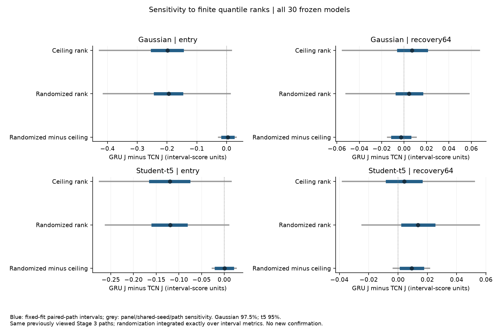
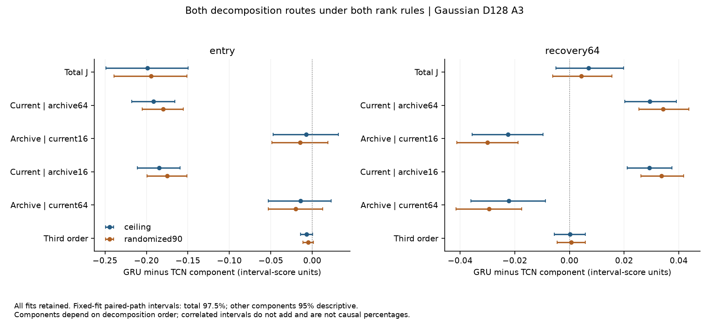

# 分位数整数秩敏感性：主要方向保留，较小效应仍会变化

日期：2026-10-18。使用全部30个已经冻结的 Stage 3 模型，以及已看过的 Gaussian/t5、D128、A3 路径。本轮没有重新训练、筛选模型或新增“盲测”。方案、源码和说明在执行前提交为 `df8db3ea91eed4f1ca90c5cfadc2f68d45e923ac`；这是针对已知局限预先固定具体做法的**事后敏感性分析**。

主要 Gaussian 架构交互的结论保持原有边界：entry 的 GRU−TCN J 均值在更换秩规则后仍为负，三个训练面板也都为负；跨训练面板和共享 seed 的敏感性区间仍包含0。Recovery 的总体差异接近0，面板方向仍不一致。此次检查增强了对特定量化规则的认识，没有建立普遍架构优劣。

需要保留两项细节：Gaussian TCN 自身原本接近0的 entry J 均值会变号；t5 recovery 的架构差异对秩规则有更明显的固定模型变化。因此不能写成“分位数取整完全不影响结果”。

## 为什么要加这一项检查

原实验用最近 W 个 normalized scores 中的第 `ceil((W+1)×0.9)` 小值作为阈值。W32取第30小，W128取第117小。若 scores 连续且交换，理想覆盖参照分别为30/33≈90.909%与117/129≈90.698%。两窗口的对比既改变历史长度，也改变了这个有限样本秩对应的水平。

本轮把两窗口的**理想秩水平**都设为90%：W32在第29与30小值之间按0.30/0.70概率选择，W128在第116与117小值之间按0.90/0.10概率选择。对两种候选区间分别评分，再按概率平均评分，得到该随机规则的期望表现。没有反复掷硬币带来的额外 Monte Carlo 噪声。

不能先平均区间宽度再评分。例如观测值1、候选半宽0.5与2、选择较宽区间的概率0.7时，期望 interval score 是6.1；在平均半宽1.55处计算分数只有3.1。两者对应不同的研究对象。代码中的独立小例子核对了这一点。

这里统一的是交换性条件下的**理想参照**，不是证明非平稳神经 scores 真能达到90%覆盖。随机规则降低了两个原始秩水平，也没有固定样本数和历史跨度。因此它是对规则的敏感性分析，不能当作唯一的“秩效应因果校正”，更不能计算“多少百分比的效应由秩解释”。

## 全部模型的 Gaussian 主要结果

J仍是 event−control 之后的 context×window 交互，不是绝对 interval score，也不是“GRU好于TCN多少”。下面的估计均为 GRU J−TCN J；最后一列还重抽训练面板与共享seed。

| Phase | 规则或配对变化 | 估计 | 固定15对拟合的97.5%路径区间 | Panel/共享seed/path敏感性区间 |
|---|---|---:|---|---|
| entry | 原整数秩 | -0.198573 | [-0.248766, -0.149846] | [-0.426968, +0.016007] |
| entry | 随机秩期望 | -0.194599 | [-0.239047, -0.151159] | [-0.413756, +0.012122] |
| entry | 配对变化：随机−原始 | +0.003974 | [-0.012415, +0.021049] | [-0.026229, +0.032452] |
| recovery64 | 原整数秩 | +0.006947 | [-0.004943, +0.019845] | [-0.054969, +0.067110] |
| recovery64 | 随机秩期望 | +0.004268 | [-0.006173, +0.015531] | [-0.051851, +0.057971] |
| recovery64 | 配对变化：随机−原始 | -0.002679 | [-0.010257, +0.004832] | [-0.014684, +0.010667] |

本轮给两个规则使用相同的新 bootstrap draws，以便在同一抽样中计算配对变化。所以原规则的点估计与冻结 Stage3 完全相同，但本表 Monte Carlo bootstrap 区间端点与旧 Stage3 表有轻微区别。原表未改写；这种端点差异不是实验数据或模型变化。

97.5%只是每个规则或变化序列内两个phase端点的近似调整，不是对所有规则、指标、分量的联合保护。其他结果为95%描述性区间，整个分析保持事后性质。固定拟合区间只反映这些已保存模型上的共同路径变化；crossed重抽仍只有三个训练面板、五个共享seed，不能替代可靠的训练总体推断。

随机规则下 Gaussian entry 的三个面板均值为−0.294336、−0.257064、−0.032398；recovery 为−0.014812、−0.010465、+0.038082。它们延续了原先的“entry方向在这三个面板保留、recovery方向随面板变化”的描述。

## 两项不能省略的敏感细节

1. **Gaussian TCN 的小均值可以变号。**其 entry J 从−0.008546变成+0.002313；两规则的固定拟合95%区间都含0，配对变化+0.010859的区间也含0。Current与archive的相反方向部分抵消后，接近0的总量不宜仅靠正负号讲机制好坏。这里不把变号本身称作显著变化。
2. **t5 recovery 的配对规则变化更明显。**架构J差异从+0.004210变为+0.013571，变化+0.009361；固定拟合95%区间[+0.002302,+0.016613]，crossed敏感性区间[−0.003218,+0.021393]。三个面板的变化均为正，但随机规则下recovery架构差异仍在面板1/2为负、面板3为正。这是已看路径上的次要描述性证据，不能升级为确认性架构结论。

T5 entry总体架构差异从−0.119736变为−0.119425；其第三面板在两规则下都略正，而前两面板为负。不能把Gaussian三个面板同号的结果推广到所有噪声家族。

## 两条分解路线与绝对表现

所有八个 current-context×archive-context×window 格子、两条分解路线、五个指标、所有seed均已保留。两路线满足同一个精确计算差分，但分量相关且依赖顺序，不是唯一因果中介比例，分量区间也不能相加。

在 Gaussian recovery 的 `current@archive64 + archive@current16` 路线上，随机规则下 GRU 两分量约为+0.057743与−0.086457，TCN为+0.023439与−0.056421；相反方向的抵消仍然存在。全部另一条路线、third-order，以及coverage、width、oracle deficit、excess width均在完整表中，没有按结果删选。

绝对区间表现保存于 [cell_performance_summary.csv](../outputs/rank_sensitivity_analysis/cell_performance_summary.csv)。该表同时有event/control和所有crossed配置。J的负号或其变化不能代替绝对 interval score、覆盖和宽度的联合比较；本轮没有据这些描述性格子挑选“最佳”部署方案。

## 复现检查与来源

本轮本地CPU计算：evaluation 442.87秒，analysis 1.91秒，新增训练数0。两图已逐张检查，文字与坐标未裁切。

- 原整数秩的92,160条逐path分量记录、1,920个crossed单元均值与冻结Stage3再现；运行时最大绝对误差分别4.44×10⁻¹⁶与1.78×10⁻¹⁵。CSV重新读入后的原始数值对比误差为0。
- 两候选秩的960条前缀与有限记忆负控制全部通过；前缀和遗忘界后半宽差最大均为0。
- 15个TCN64快速推理检查均满足原有相对/绝对容差；所有原始训练文件与模型哈希在前后保持一致。
- 全部候选秩×模型×family×world×8cells×phase×path×5metrics存为索引清楚的NPZ，analysis从中重建全部分量及格子均值后才计算统计。
- 固定拟合和crossed bootstrap有独立标量toy循环核验，误差≤8.89×10⁻¹⁶；缺失、重复、越界身份被拒绝。

来源入口：[协议](rank_sensitivity_protocol.md)、[JSON协议](../configs/rank_sensitivity_protocol.json)、[evaluation manifest](../outputs/rank_sensitivity/manifest.json)、[analysis manifest](../outputs/rank_sensitivity_analysis/manifest.json)、[完整summary](../outputs/rank_sensitivity_analysis/summary.csv)、[全部拟合](../outputs/rank_sensitivity_analysis/individual_fits.csv)、[逐面板](../outputs/rank_sensitivity_analysis/panel_summary.csv)、[删一面板](../outputs/rank_sensitivity_analysis/leave_one_panel_out.csv)、[运行与理解说明](rank_sensitivity_runbook.md)。

本轮更适合写进最终报告的结论是：**在已保存的Gaussian比较中，主要entry架构交互在这个固定的共同秩水平检查下保留了方向；较小的TCN总交互与t5 recovery等量仍对规则敏感，训练随机性和失败重复的限制继续成立。**这是一项有明确边界的稳健性检查，不是新算法，也不是A+评分保证。
