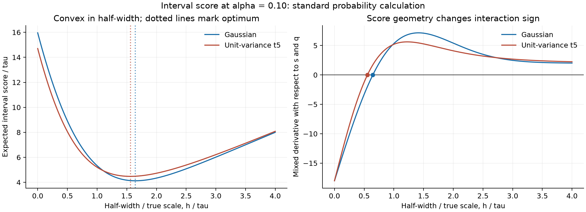
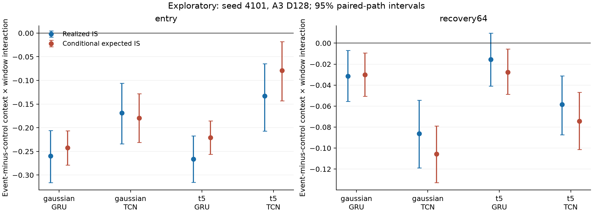

# 探索性补充：interval score 的曲率与当前创新噪声

对 seed 4101 的两个已经查看过的 reference case，把每个时点当前创新积分掉后，GRU/TCN 的 entry interaction 仍为负，GRU−TCN 在 entry 为负、recovery64 为正。这个现象在该单个拟合对中并非只由当前时点偶然的大收益值产生；它没有解决五个初始化之间的排序不稳定，也不能替代冻结的 Stage 2 primary analysis。

本补充于 2026-10-11 在 Stage 2 结果已经查看后指定，因此全部计算、图和 95% path 区间均为 **exploratory**。只使用既有 Gaussian/t5、amplitude 3、duration 128 的两个 reference NPZ，四个 seed 4101 预测器（GRU/TCN × context16/64），rolling32/128，event 与 matched control，128 条配对 path。没有新训练、参数选择、新 holdout 或改写 primary 指标。

## 标准评分规则与基本计算

对于对称区间 `[-h,h]`，本项目使用越小越好的 interval score：

\[
IS_\alpha(h;y)=2h+\frac{2}{\alpha}(|y|-h)_+.
\]

这对应 [Gneiting–Raftery (2007) 式 (43)、§6.2](https://sites.stat.washington.edu/people/raftery/Research/PDF/Gneiting2007jasa.pdf) 的标准 interval score；原文同时在 §6.3 讨论条件异方差序列中的区间评价。以下高斯/t5 尾积分、导数和微积分恒等式是本项目的基础解释计算，**没有声称是新评分规则或原创定理**。

令 `s` 为仅使用过去观测发出的正尺度，`q` 为仅使用过去 issued scores 的正分位数，半宽 `h=sq`。令 `τ` 为模拟器已知的真实标准差。本补充只在事后评分中使用 `τ` 和真实分布；预测器、warmup 和校准分位数仍使用原先冻结的过去观测。

对于 `Y=τZ`、`Z~N(0,1)`，写 `z=h/τ`，`φ` 为标准正态密度，`S(z)=1−Φ(z)` 为 survival function。有

\[
R(h;\tau)=\mathbb E[IS_\alpha(h;Y)]
=2h+\frac{4}{\alpha}\{\tau\phi(z)-hS(z)\},
\]

\[
R_h=2-\frac{4}{\alpha}S(z),\qquad
R_{hh}=\frac{4\phi(z)}{\alpha\tau}>0,
\]

\[
\frac{\partial^2R(sq;\tau)}{\partial s\partial q}
=R_h+hR_{hh}
=2-\frac{4}{\alpha}\{S(z)-z\phi(z)\}.
\]

对于单位方差 t5，先保留一般 `ν>2` 形式：`Y=τcT_ν`，`c=√((ν−2)/ν)`，`a=h/(τc)`，`f_ν` 和 `S_ν` 分别为标准 Student-t 的 density/survival function。由
`∫_a^∞ x f_ν(x)dx = (ν+a²)f_ν(a)/(ν−1)` 得到

\[
R(h;\tau)=2h+\frac{4}{\alpha}
\left\{\tau c\frac{\nu+a^2}{\nu-1}f_\nu(a)-hS_\nu(a)\right\},
\]

\[
R_h=2-\frac{4}{\alpha}S_\nu(a),\qquad
R_{hh}=\frac{4f_\nu(a)}{\alpha\tau c}>0,
\]

\[
\frac{\partial^2R(sq;\tau)}{\partial s\partial q}
=2-\frac{4}{\alpha}\{S_\nu(a)-a f_\nu(a)\}.
\]

`R` 关于半宽 `h` 是凸的，其最小值对应正确的两侧尾概率 `α/2`。但关于两个乘法因子 `s` 和 `q` 的 mixed derivative 可以为负或为正。`α=.1` 时：

| 分布 | mixed derivative 零点 `h/τ` | 最优半宽 `h/τ` |
| --- | ---: | ---: |
| Gaussian | 0.645918 | 1.644854 |
| Unit-variance t5 | 0.555012 | 1.560850 |

这里的零点是数值求根结果，最优半宽是相应真实分布的 95% 分位数。不能把 mixed derivative 的零点当作应选择的目标半宽。



## 为什么负 interaction 不直接表示某种记忆有害

先把 archive 分母固定为某个 context `b`。比较两个当前尺度 `s0,s1` 与两个 rolling 窗口产生的分位数 `q0,q1` 时，单时点的 expected-score 2×2 差分为

\[
D=R(s_1q_1)-R(s_0q_1)-R(s_1q_0)+R(s_0q_0)
=\int_{s_0}^{s_1}\int_{q_0}^{q_1}
\frac{\partial^2R(sq)}{\partial s\partial q}\,dq\,ds.
\]

积分是有方向的：`s1<s0` 或 `q1<q0` 会改变矩形方向。即使两种因子变化方向相同，改变区间所处的分布位置，也可能因 mixed derivative 不同而改变交互符号。独立 toy 计算的 Gaussian 中，同样增加 `s` 与 `q`，很窄区间的矩形差分为 −0.9130，接近 nominal 半宽的另一矩形为 +0.5437；t5 对应为 −0.8756 与 +0.4025。两个矩形大小也不同，这里只是说明正负号并非固定，未将它们当成效果大小对照。

本项目原来的 diagonal `J` 还同时改变 archive 分母，并再减去 matched-control 的差分。因此其正负号包含当前尺度差异、分位数差异、评分非线性与两个世界的差异，无法从一个符号直接读出“长上下文有害”或“GRU 绝对性能优于 TCN”。跨模型排序还需要独立查看绝对 interval score、coverage、width 和初始化稳定性。

本次真实 reference 诊断中，event entry 的各 diagonal 配置处于负 mixed derivative 区域的时点比例仅约 2.95%–6.76%，recovery64 约 0%–0.21%。这些是各 cell 端点的比例，不能代表整个有向矩形内部的曲率，更不能据此认定负曲率导致本次负 `J`。该公式主要用于解释为何需拆分因子与评价指标；尚未量化具体路径中“曲率的贡献比例”。

## 把当前创新积分掉后的单 seed 对照

对于 Gaussian/t5 reference，未来当前创新在给定过去信息后独立，且真实尺度由模拟设计确定。用发出的 `h_t` 计算 `R(h_t;τ_t)`，会积分掉当前 `y_t` 的创新，但保留历史观测影响 `s_t`、`q_t` 所产生的随机性。matched event/control 共用当前创新，不被当成独立样本。每条 path 内先计算相同的 event-minus-control diagonal `J`，再跨 128 条独立配对 path 平均。

| family | phase | model | 实现 IS 的 `J` | 条件期望 IS 的 `J` | expected `J` 的 95% path 区间 |
| --- | --- | --- | ---: | ---: | --- |
| Gaussian | entry | GRU | −0.25970 | −0.24245 | [−0.27899, −0.20669] |
| Gaussian | entry | TCN | −0.16874 | −0.17942 | [−0.23111, −0.12796] |
| Gaussian | recovery64 | GRU | −0.03148 | −0.03021 | [−0.05071, −0.00936] |
| Gaussian | recovery64 | TCN | −0.08624 | −0.10553 | [−0.13276, −0.07880] |
| t5 | entry | GRU | −0.26641 | −0.22080 | [−0.25608, −0.18543] |
| t5 | entry | TCN | −0.13308 | −0.07924 | [−0.14286, −0.01817] |
| t5 | recovery64 | GRU | −0.01544 | −0.02781 | [−0.04882, −0.00564] |
| t5 | recovery64 | TCN | −0.05856 | −0.07428 | [−0.10123, −0.04672] |

相应 GRU−TCN 的 expected-score contrast 在 Gaussian entry 为 −0.06304、recovery64 为 +0.07532；t5 entry 为 −0.14156、recovery64 为 +0.04648。它们与该 seed 的实现 IS contrast 方向一致，大小有变化。实现减去条件期望的 contrast，四个相应 95% path 区间均包含 0。不过单个架构的 t5 entry residual 区间可以不含 0；这也是为什么必须完整保留两种读数和全部范围，不能宣称二者在有限样本中完全相同。



本次 eight architecture-specific `J` 中，expected 读数的 path 标准差都小于实现读数，但这只是当前样本观察。逐时点积分对条件期望的性质，不自动保证有时间依赖的 phase 平均、跨配置 interaction 或配对世界差分都有更小方差；当前创新也会进入后续区间的历史。我们没有将此步骤宣传为通用 variance-reduction 定理。

本补充另存了固定 archive16/64 的 current-context × window 差分。在 Gaussian GRU recovery64，expected 分量分别为 +0.06016/+0.08161，但 diagonal expected `J` 为 −0.03021，说明 archive 的改变与原总交互的解释不能省略。它们只是两种明确固定 archive 的干预读数，不是唯一的中介贡献或百分比分解。完整单 seed 结果见 [fixed archive summary](../outputs/stage2_score_geometry/fixed_archive_summary.csv)。

## 验证、来源与复现

脚本 [stage2_score_geometry.py](../scripts/stage2_score_geometry.py) 在首次读取 reference NPZ 之前提交为 `63d6a7e`。运行只花费约 6.36 秒；两个 NPZ 均先与原 evaluation manifest 的 SHA256 比对，验证协议、训练 manifest 与 validation warmup 的引用一致。original realized diagonal path interaction 共 2048 行逐个重现，最大绝对误差 `1.11e−16`；late realized/expected interaction 均为 0。

独立数值验证包括 42 个尾部积分 case、36 个正的一维半宽位置的三种 finite differences、10 个有向矩形积分对照，以及最优半宽导数为 0 的检查。最大误差如下：

| 检查 | 最大绝对误差 |
| --- | ---: |
| expected score vs 独立尾部数值积分 | 1.42e−14 |
| 一阶导数 vs central finite difference | 2.42e−8 |
| 二阶导数 vs central finite difference | 2.43e−6 |
| mixed derivative vs 2D central finite difference | 5.00e−6 |
| 2×2 contrast vs 48-node Gauss–Legendre 有向矩形积分 | 1.02e−14 |

全部 42 个积分 case、数值检查误差和符号示例保存在 [numerical_checks.json](../outputs/stage2_score_geometry/numerical_checks.json)。[manifest](../outputs/stage2_score_geometry/manifest.json) 记录设计是已见结果后的探索性补充、代码及输入来源、bootstrap seed 890311 和输出 artifact hashes。CSV gzip 固定 `mtime=0`。置信区间是 4000 次 paired-path percentile bootstrap 的 95% **未校正描述性区间**，conditional on 单个冻结拟合对；不是初始化总体推断，也未将路径内时点当成独立样本。

发布前的追加独立审核保存在 [publication_audit.json](../outputs/stage2_score_geometry/publication_audit.json)：warmup 文件 hash 与已经完成的 strong-supplement manifest 一致；使用四条指定路径、标量 `sort` 的过去窗口定义重算 64 个 path/phase interaction，最大误差 `8.76e−17`；另对真实 reference 发出的 32 个半宽独立尾积分，最大误差 `1.07e−14`。这一步只追加审核记录，没有更改源码或任何统计读数。

```sh
.venv/bin/python scripts/stage2_score_geometry.py --self-check
# 只在输出目录不存在的独立 checkout 中运行，已有 manifest 会拒绝覆盖。
.venv/bin/python scripts/stage2_score_geometry.py
```

当前可辩护的用途是帮助学生准确解释 interaction，给冻结预测器提供一个可审计的 oracle scoring 诊断。可辨识的课程原创贡献仍应来自完整研究问题、独立实验与机制证据的组合；基础微积分本身不应被包装成创新。
