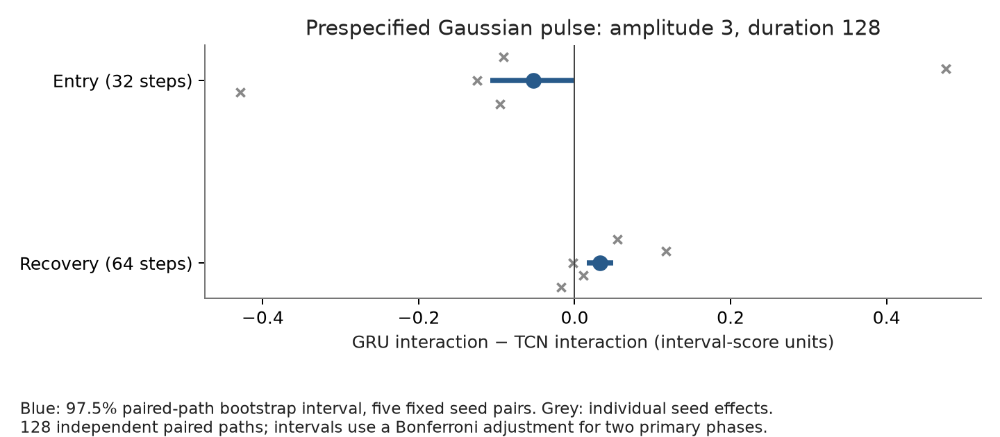
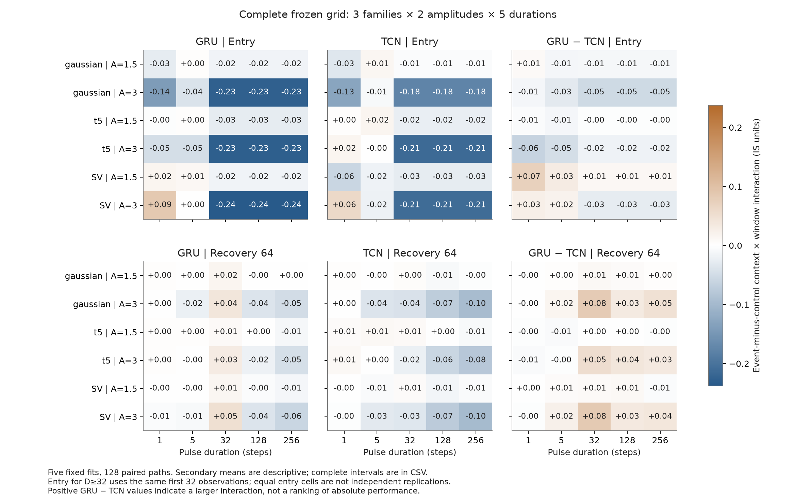
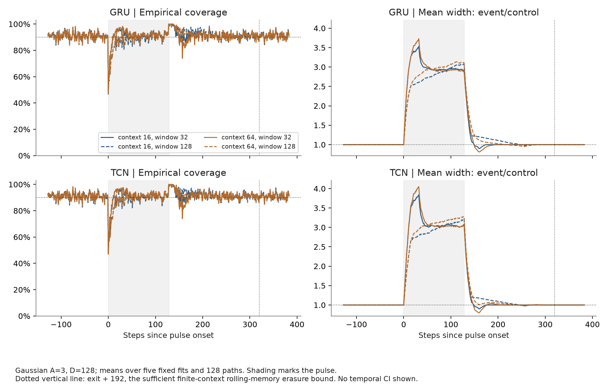

# Stage 2：统一训练后的独立配对测试

主要发现是：五对固定拟合的平均 interaction 存在小幅的 entry/recovery 差异，但 GRU − TCN 的排序对初始化很敏感。Entry 的条件区间仅擦边不含 0，删去 seed 4104 后均值翻为正；两个 phase 的 crossed seed/path 敏感性区间都包含 0。当前不能支持稳定的架构优劣或“长记忆普遍有害”的结论。

日期：2026-10-11。全部 10 个冻结拟合和全部 30 个预先指定测试 case 均已完成。分析没有返回训练、修改 checkpoint 或挑选测试中的最优 case。当前结果检验的是两个具体拟合程序的尺度响应与滚动分数窗口的交互；它本身不构成 A+ 保证，也不是已经证明有优势的新方法。

## 预定主要结论

- `entry` 的 GRU − TCN interaction 为 -0.05287，97.5% 区间 [-0.10789, -0.00036]，在预定的条件区间中为负。五个 seed 的均值范围 [-0.42866, +0.47620]；leave-one-seed-out 范围 [-0.18513, +0.04108]。
- `recovery64` 的 GRU − TCN interaction 为 +0.03276，97.5% 区间 [+0.01552, +0.04922]，在预定的条件区间中为正。五个 seed 的均值范围 [-0.01723, +0.11717]；leave-one-seed-out 范围 [+0.01166, +0.04526]。

| phase | GRU interaction | TCN interaction | GRU−TCN | 97.5% low | 97.5% high | crossed low | crossed high |
| --- | --- | --- | --- | --- | --- | --- | --- |
| entry | -0.2280 | -0.1752 | -0.0529 | -0.1079 | -0.0004 | -0.3206 | 0.2824 |
| recovery64 | -0.0385 | -0.0712 | 0.0328 | 0.0155 | 0.0492 | -0.0138 | 0.0902 |

这里的 interaction 已经是 event-minus-matched-control 的 2×2 差分：`[(context64,W128−context16,W128)−(context64,W32−context16,W32)]event − 同一项control`。主 contrast 再取 GRU interaction − TCN interaction。正号只表示 GRU 的该交互更大，不能等同于 GRU 的绝对区间分数更差，更不能直接推出“长记忆有害”。Interval score 越小越好，但 interaction 是数个性能差值的组合。

主要 case 预先固定为 Gaussian、amplitude 3、duration 128；entry 为前 32 个冲击时点，recovery64 为退出后的前 64 个时点。区间使用 4000 次 paired-path percentile bootstrap，先平均五对**固定**已拟合模型，再重抽 128 条独立配对 path。两端点用 97.5% marginal interval 作 Bonferroni 调整；这是 bootstrap 近似，不是有限样本严格覆盖定理。表中的 crossed seed/path 区间只是敏感性检查，不能从五个初始化推断初始化总体显著性。训练数据固定，模型 seed 并不代表重抽训练数据。



## 全部初始化与全网格

| phase | seed | gru_interaction | tcn_interaction | estimate |
| --- | --- | --- | --- | --- |
| entry | 4101 | -0.2597 | -0.1687 | -0.0910 |
| entry | 4102 | -0.2343 | -0.7105 | 0.4762 |
| entry | 4103 | -0.2348 | -0.1100 | -0.1248 |
| entry | 4104 | -0.2099 | 0.2188 | -0.4287 |
| entry | 4105 | -0.2014 | -0.1053 | -0.0961 |
| recovery64 | 4101 | -0.0315 | -0.0862 | 0.0548 |
| recovery64 | 4102 | -0.0372 | -0.1544 | 0.1172 |
| recovery64 | 4103 | -0.0418 | -0.0394 | -0.0023 |
| recovery64 | 4104 | -0.0282 | -0.0397 | 0.0115 |
| recovery64 | 4105 | -0.0536 | -0.0364 | -0.0172 |

完整 secondary 文件包含全部 `3 noise families × 5 durations × 2 amplitudes × 4 phases × 5 metrics`，并分别保留 GRU、TCN、EWMA interaction，以及全部 GRU − TCN contrast。95% secondary 区间未做多重检验校正，只用于描述。不同 duration 和 amplitude 共用每个 family 的相同噪声路径；不能把所有 case 再合并为独立样本。

在 amplitude 3 且 duration≥32 时，GRU 的 entry interaction 在 Gaussian/t5/SV 三个 family 分别约为 −0.228/−0.229/−0.238，TCN 约为 −0.175/−0.212/−0.211。但 duration 32/128/256 的 entry 数值完全相同：entry 只评分最初 32 个时点，因果预测器尚未看到之后的退出时间，且这三个 case 共用同一噪声。因此不能把相同 entry 数值宣传为三次独立的 duration 鲁棒性复制。

Recovery 则确实随着退出时间改变。Amplitude 3 时，GRU 的 recovery64 interaction 在 duration32 为 +0.031～+0.049，在 duration128 为 −0.019～−0.039，在 duration256 为 −0.045～−0.059；TCN 在这些较长冲击下大多更负。全部 30 个 case 的 GRU − TCN interval-score interaction，entry 为 22 负/8 正，recovery64 为 21 正/9 负；这些是相关网格的描述性计数，不是显著性检验。EWMA 的相同 interaction 在 amplitude3 的持久 entry 约为 +1.85～+2.00，与神经模型的方向不同，提示应进一步区分尺度响应和分数归档机制；它不能推出神经模型绝对性能更优。



- [全部 architecture-specific interaction 与区间](../outputs/stage2_analysis/secondary_interactions.csv)
- [全部 GRU − TCN contrast 与区间](../outputs/stage2_analysis/secondary_architecture_contrasts.csv)
- [全部 individual-seed effects](../outputs/stage2_analysis/individual_seed_effects.csv)
- [全部 leave-one-seed-out primary estimates](../outputs/stage2_analysis/primary_leave_one_out.csv)
- [全部绝对表现汇总：event 与 control、native/rolling32/rolling128](../outputs/stage2_analysis/performance_summary.csv)

## 绝对表现与覆盖代价

下面统一展示主要 Gaussian A3 D128 case 的 native Gaussian 区间，以免把 interaction 的符号误读为绝对性能排序。IS 是 interval score，越小越好；coverage 是已实现包含率。神经模型列是五个固定拟合的均值，统计控制列是同一组 path 的单个冻结拟合。此表是描述性对照，没有给绝对性能差额作置信区间或显著性声明；所有 rolling32/128、event/control 和另外 29 个 case 都保留在上面的完整 CSV。

| Native predictor | Entry IS | Entry coverage | Recovery64 IS | Recovery64 coverage |
| --- | ---: | ---: | ---: | ---: |
| Constant | 17.3514 | 61.82% | 5.3251 | 99.38% |
| EWMA16 | 14.6103 | 76.03% | 5.6031 | 96.89% |
| EWMA64 | 18.0093 | 60.45% | 7.5467 | 99.93% |
| Fitted GARCH(1,1) | 13.7336 | 81.25% | 5.0196 | 94.48% |
| GRU context16 | 13.8183 | 79.51% | 4.8307 | 93.89% |
| GRU context64 | 13.7803 | 80.17% | 5.0617 | 94.54% |
| TCN context16 | 13.9366 | 80.65% | 4.9252 | 94.38% |
| TCN context64 | 14.0011 | 80.78% | 5.0573 | 94.23% |

没有单一配置在 entry/recovery 的 score 与 coverage 上都占优。以 GRU context16 为例，rolling32 将 entry coverage 从 79.51% 提高到 87.63%，同时平均宽度从 7.8024 增到 10.7012，IS 从 13.8183 增到 14.4094。相同 rolling32 的 recovery64 coverage 为 92.36%、IS 为 5.2191；rolling128 的 entry coverage 为 79.64%、IS 为 14.0043，recovery coverage 为 95.64%、IS 为 5.2726。这些数值展示覆盖、宽度和效率之间的相位依赖权衡，不能以只展示 coverage 或只展示某个 phase 的最好值来宣称方法改进。

强校准补充也已完成：[single-seed ACI/SF-OGD/SAOCP readout](stage2_strong_supplement_results.md)。它只覆盖 Gaussian/t5、A3 D128、seed4101 的两个架构和两个上下文；固定参数、全部配置保留，主面板 native/rolling 读数与该补充一致。它提供覆盖与区间效率的额外对照，不能替代五个 seed 的主推断或推广为算法总体胜负。

## 恢复边界与指标含义

共检查 1800 个神经模型 context/calibrator/case 组合。退出 192 个时点以后，event 与 matched-control 的最大绝对宽度误差为 `0`。这是固定长度上下文 16/64 与过去分数 rolling32/128 的充分记忆消失边界验证；它不适用于保留无限历史或额外状态的 EWMA、GARCH、ACI、SF-OGD、SAOCP，也不保证真实市场的路径重新重合。因果前缀、过去分数分位数、上下文缓存与独立重算边界检查已通过。



Coverage 是真实已实现包含率；coverage deficit 使用已知模拟分布的区间包含概率。Gaussian/t5 的 oracle 指定清楚；SV 的条件概率和 oracle width 条件于模拟潜在状态，**不是**观测历史下可部署预测的条件概率。图中的均值平均五个固定拟合后再平均 128 条 path，未把 640 个 model/path 组合当成独立样本。曲线没有逐时点置信带，不能据单个时点的起伏宣称显著变化。

## 深度学习与有效记忆诊断

GRU 与 TCN 使用同一训练/验证观测、相同目标与输入特征、共同批次采样前缀、同一验证选择规则。参数量为 2041 与 1897，early stopping 使优化总步数可以不同，因此比较仍然是这两个冻结拟合程序；不能把任何差异全部归因于架构本身。10 个模型都按 validation patience 结束，未触及 60 epoch 上限。

| architecture | older>16 gradient fraction min | older>16 gradient fraction max | older permutation mean abs(Δlogσ) min | older permutation mean abs(Δlogσ) max |
| --- | --- | --- | --- | --- |
| gru | 0.0931 | 0.1357 | 0.0578 | 0.0854 |
| tcn | 0.2321 | 0.2999 | 0.0774 | 0.1259 |

诊断只读取冻结验证集的前 256 个既有目标对。older48 block 的梯度质量、置换前后 logσ 差异与 context16/64 差异说明模型对较旧输入的局部敏感性；梯度不是长记忆的因果证明，置换可产生分布外上下文。这些目标可能来自相同路径并且上下文重叠，未声称 256 条独立样本的置信区间。完整图与记录见 [validation memory diagnostics](../outputs/stage2_memory/manifest.json)。

TCN 的旧输入梯度份额普遍高于 GRU，但这不足以预测每个 seed 的 interaction 方向。例如 TCN 4102/4104 的旧输入梯度份额都较高（0.300/0.265），entry interaction 却为 −0.710/+0.219。两者验证 NLL 为 0.8742/0.8658，说明拟合状态也有差别；只有五个拟合、且没有训练数据重抽样，不能据此拟合显著性回归或确认因果机制。该非单调例子只是进一步交叉 archive 干预的动机。

## 与 A+ 目标之间还缺什么

这一步补上了第 1 阶段 MLP/GRU 比较中的主要混杂：统一数据、输入、checkpoint 选择规则、五个 seed 配对与独立测试，并保留零效应或反向效应。它提高了研究结论的可信度；课程 A+ 仍然要求可辨识、充分论证的原创贡献，不能用完成训练次数、漂亮图或单个区间不含 0 来替代。

接下来适合用这批冻结预测器做 current-scale 与 historical-score archive 的独立交叉干预，分离“当前尺度响应”和“归档分母污染”两个来源。该补充将受到当前结果启发，应明确标记为 exploratory；若要再作 confirmatory claim，需先固定新对照和新随机种子，再生成新的独立测试。还需要核对直接相关研究中的 replay、reset、neural controller 等已有方法，避免把已有组件当成新贡献。强 calibration 补充和真实公开金融数据的结果应单独展示其范围；当前 ECB 测试时期已经探索过，不能追溯改称未见过的最终 holdout。

如尝试一个有依据的校准策略，其选择必须使用 train/validation 信息，最终结论应同时报告 interval score、coverage、width，以及失败条件和代价。当前主实验没有训练或验证这样一个新策略，所以本报告不声称性能提升。AI 使用已获课程许可；学生仍须理解全部假设、代码与实验并按课程要求承担署名与成果责任。

## 复现与来源

```sh
.venv/bin/python scripts/analyze_stage2.py --self-check
.venv/bin/python scripts/analyze_stage2.py
```

分析脚本在读取真实第二阶段测试输出前已提交。manifest 校验冻结协议、训练源码、10 个 checkpoint、控制模型、evaluation 全部 artifact SHA256 后才计算统计；记录输入 SHA256、分析源码 SHA256 和 bootstrap seed/rules。分析不会重新生成测试或改变模型。[analysis manifest](../outputs/stage2_analysis/manifest.json) 和 [frozen protocol](../configs/stage2_protocol.json) 是具体来源。

第一次输出后的人工 readout 只补充解释与绝对性能表，没有修改任何统计 CSV 或分析源码。单独的 `scripts/render_stage2_grid.py` 修复图例遮挡，将 coverage 刻度显示为百分比，并统一两个 width-ratio 面板的纵轴；manifest 分别保留原分析源码哈希、追加 rendering 来源和当前报告哈希。
