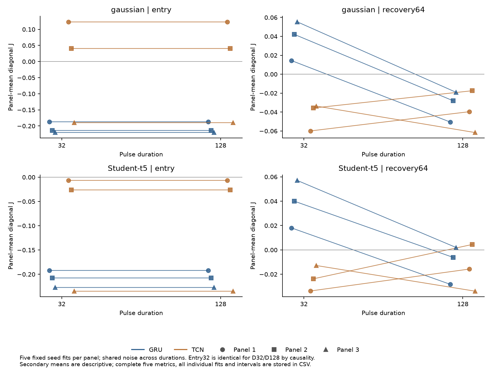
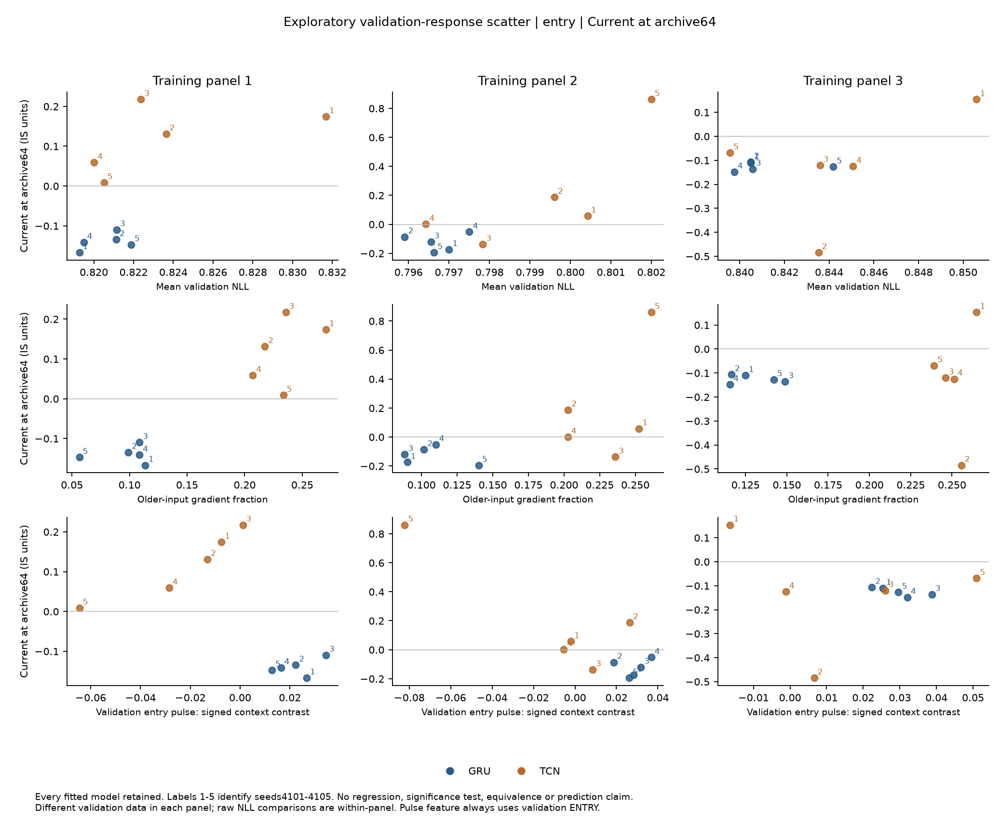
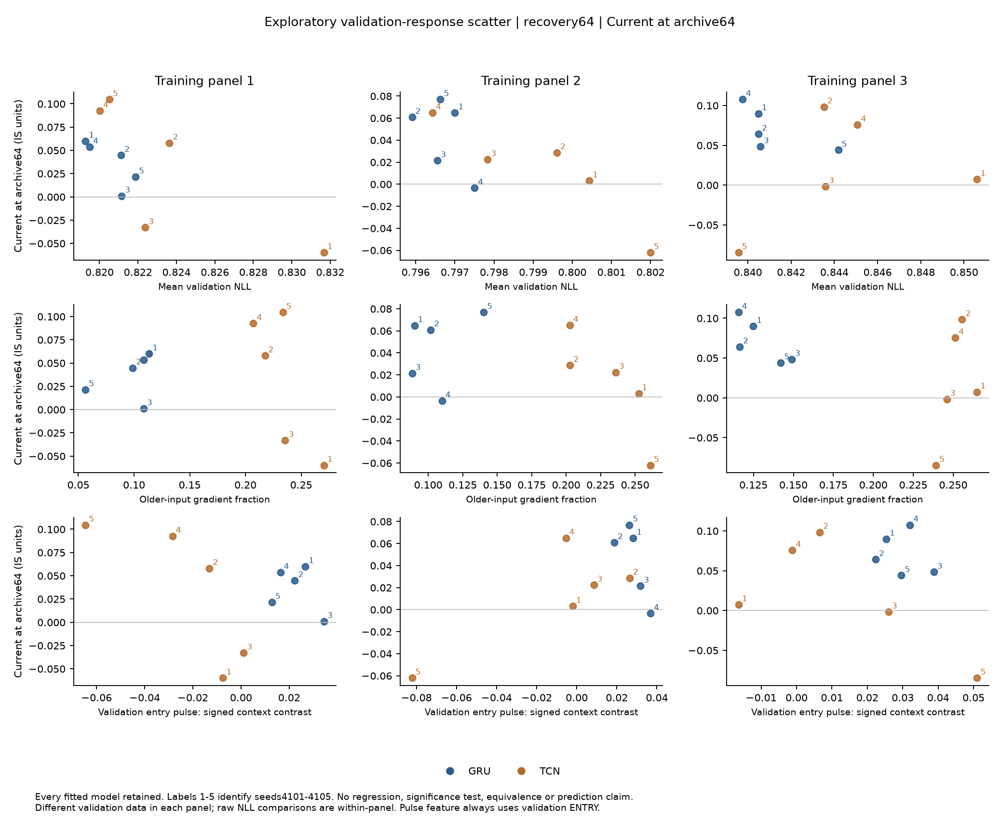

# Stage 3：独立训练数据重复与验证响应诊断

三个新训练/验证面板、每面板五个配对初始化/采样seed、两个架构的全部30个拟合，以及新的4个测试case都已评估。Gaussian D128 A3 的 entry 架构contrast在三个panel均为负，固定模型的路径区间也不含零；但重抽训练panel与共享seed的敏感性区间包含零，尚不能推出训练总体中的稳定架构排序。Recovery64的总体差异接近零且随panel改号，先前探索阶段的正向架构contrast未得到稳定重复。

通道分解保留了更具体的描述性现象：Gaussian entry 中，TCN current分量的seed标准差在全部 **6/6** 个panel×分解路线组合均大于GRU current；同时大于自身archive的组合只有 **4/6**，panel1两路线均由archive变异更大。因此可以报告两程序的通道变异不同，不能声称current普遍主导不稳定性。这些相关组合不是六次独立检验；全部seed与两条分解路线均保留。

日期：2026-10-11。Stage3是受Stage2启发、在新训练及新测试访问前冻结的重复研究；没有新算法选择、checkpoint修改或模型排除。原训练预处理 `(raw/3, log1p(abs(raw)))`、零均值Gaussian尺度head、上下文16/64混合训练、优化与early-stopping规则均保持不变。唯一训练协议变化是独立train/validation数据seeds及输出目录。这里比较两个具体训练程序，参数量和优化历程仍不完全相同。

## 主要读数与统计对象

- `entry`：GRU−TCN = -0.19857，固定15对拟合的97.5%路径区间 [-0.24939, -0.14849]；crossed敏感性区间 [-0.42548, +0.01792]。逐panel均值：panel1=-0.31008、panel2=-0.25474、panel3=-0.03089；删一panel范围 [-0.28241, -0.14282]。
- `recovery64`：GRU−TCN = +0.00695，固定15对拟合的97.5%路径区间 [-0.00521, +0.01922]；crossed敏感性区间 [-0.05893, +0.06728]。逐panel均值：panel1=-0.01103、panel2=-0.01067、panel3=+0.04254；删一panel范围 [-0.01085, +0.01594]。

| phase | gru_interaction | tcn_interaction | estimate | ci_low | ci_high | crossed_sensitivity_low | crossed_sensitivity_high |
| --- | --- | --- | --- | --- | --- | --- | --- |
| entry | -0.20712 | -0.00855 | -0.19857 | -0.24939 | -0.14849 | -0.42548 | +0.01792 |
| recovery64 | -0.03265 | -0.03959 | +0.00695 | -0.00521 | +0.01922 | -0.05893 | +0.06728 |

J为已做event−matched-control的diagonal context×window interaction；主要contrast取J_GRU−J_TCN。正负不能直接当绝对区间分数排名或长记忆损害。主要case固定Gaussian D128 A3、interval score、entry32/recovery64两个phase。

窗口对比也包含有限分位数秩的离散：冻结程序取 `k=ceil((W+1)×0.9)`，W32对应k30，W128对应k117。在连续、联合交换scores的理想参照下，覆盖分别为30/33≈90.909%与117/129≈90.698%；这不是本实验相依、非平稳scores的覆盖保证。因此W对比同时改变历史长度、经验分位数变动及有限秩水平，event−control未被证明完全消除rank影响。程序、秩和所有统计均保持冻结定义；说明见[有限分位数秩备注](quantile_rank_notes.md)。

4000次bootstrap先对 **3×5=15对固定拟合** 求平均，再共同重抽128条独立paired paths；两个phase使用97.5% marginal intervals作Bonferroni近似调整。这些区间条件于保存的模型，不是初始化或训练数据总体推断。逐panel的97.5%区间仅描述，不是对六个panel×phase端点的联合校正。Crossed敏感性另重抽3个训练panel、5个seed索引和path；同一seed draw用于所有抽到的panel，保留共享初始化/采样设计。三个panel和五seed不足以给稳定总体结论。两个架构共有path，duration32/128共有family基础噪声，不能把30fits×128paths当3840个独立样本。


## 三个训练panel与全部初始化

| phase | panel | gru_interaction | tcn_interaction | estimate | seed_std | seed_min | seed_max |
| --- | --- | --- | --- | --- | --- | --- | --- |
| entry | 1 | -0.18685 | +0.12324 | -0.31008 | +0.08861 | -0.43266 | -0.23381 |
| entry | 2 | -0.21389 | +0.04085 | -0.25474 | +0.29171 | -0.73797 | -0.02082 |
| entry | 3 | -0.22062 | -0.18973 | -0.03089 | +0.15629 | -0.18975 | +0.14393 |
| recovery64 | 1 | -0.05064 | -0.03961 | -0.01103 | +0.09019 | -0.12453 | +0.11297 |
| recovery64 | 2 | -0.02814 | -0.01747 | -0.01067 | +0.03842 | -0.04261 | +0.04509 |
| recovery64 | 3 | -0.01916 | -0.06170 | +0.04254 | +0.06011 | -0.04673 | +0.11771 |

[全部15对individual contrasts](../outputs/stage3_analysis/primary_individual_seeds.csv)、[全部case/phase/metric individual effects](../outputs/stage3_analysis/individual_seed_effects.csv)与[删一训练panel](../outputs/stage3_analysis/primary_leave_one_panel_out.csv)保留全部seed，未以验证或测试排名删除模型。Seed标准差是每panel五个固定seed均值的样本标准差，不能转换为方差贡献百分比。

四个case为Gaussian/t5×D32/D128×A3。Entry只看共同最初32步；两duration的entry J和全部components逐path一致，最大误差为 `0`。这来自因果前缀与共同噪声，不能算两次duration鲁棒性重复。Recovery评分时刻随duration改变。全四phase、五指标均保留：[secondary interactions](../outputs/stage3_analysis/secondary_interactions.csv)、[architecture contrasts](../outputs/stage3_analysis/secondary_architecture_contrasts.csv)。95% secondary区间仅描述、未作多重校正。



## Current与archive的两条路线

`total = current_at_archive64 + archive_at_current16 = current_at_archive16 + archive_at_current64`。分量是crossed factorial的精确计算差分，不是唯一因果中介比例；两路线可以不同，相关分量CI端点不可相加。

| architecture | phase | total | current_at_archive64 | archive_at_current16 | current_at_archive16 | archive_at_current64 | third_order |
| --- | --- | --- | --- | --- | --- | --- | --- |
| gru | entry | -0.20712 | -0.13024 | -0.07687 | -0.13347 | -0.07365 | +0.00322 |
| gru | recovery64 | -0.03265 | +0.05035 | -0.08300 | +0.03222 | -0.06487 | +0.01813 |
| tcn | entry | -0.00855 | +0.06112 | -0.06967 | +0.05106 | -0.05961 | +0.01006 |
| tcn | recovery64 | -0.03959 | +0.02097 | -0.06057 | +0.00302 | -0.04261 | +0.01796 |

| phase | panel | route | gru_current_seed_std | gru_archive_seed_std | tcn_current_seed_std | tcn_archive_seed_std |
| --- | --- | --- | --- | --- | --- | --- |
| entry | 1 | archive64_first | +0.02086 | +0.07338 | +0.08451 | +0.19092 |
| entry | 1 | current64_first | +0.02033 | +0.07226 | +0.08563 | +0.19432 |
| entry | 2 | archive64_first | +0.05908 | +0.08341 | +0.39081 | +0.17937 |
| entry | 2 | current64_first | +0.06158 | +0.08535 | +0.34581 | +0.15568 |
| entry | 3 | archive64_first | +0.01749 | +0.03351 | +0.22906 | +0.17235 |
| entry | 3 | current64_first | +0.01840 | +0.03530 | +0.21606 | +0.15814 |
| recovery64 | 1 | archive64_first | +0.02450 | +0.01853 | +0.07460 | +0.04184 |
| recovery64 | 1 | current64_first | +0.02390 | +0.01572 | +0.09201 | +0.04333 |
| recovery64 | 2 | archive64_first | +0.03379 | +0.02166 | +0.04676 | +0.07677 |
| recovery64 | 2 | current64_first | +0.02882 | +0.01567 | +0.04343 | +0.06891 |
| recovery64 | 3 | archive64_first | +0.02729 | +0.01632 | +0.07215 | +0.04393 |
| recovery64 | 3 | current64_first | +0.01986 | +0.01132 | +0.08989 | +0.05301 |

[完整逐panel variability](../outputs/stage3_analysis/component_variability.csv)、[全部components汇总](../outputs/stage3_analysis/component_summary.csv)、[全部individual components](../outputs/stage3_analysis/individual_seed_components.csv)包括t5、D32与另外三指标/phase。不预设TCN必更不稳定，current与archive也不必同向。固定archive时current×window的log-width交互为零是代数性质；非线性interval score的交互可以非零，不能把恒等式或有限遗忘界包装为新定理。

## 绝对表现与覆盖代价

主参考case的原生Gaussian区间、event world描述均值如下；coverage为比例，IS越小越好。它与J的差分问题不同。

| architecture | context | phase | interval_score | coverage | width |
| --- | --- | --- | --- | --- | --- |
| gru | 16 | entry | +14.14570 | +0.79040 | +7.83738 |
| gru | 16 | recovery64 | +4.78929 | +0.93822 | +4.28253 |
| gru | 64 | entry | +14.15625 | +0.79408 | +7.93790 |
| gru | 64 | recovery64 | +4.98565 | +0.94419 | +4.54376 |
| tcn | 16 | entry | +14.28210 | +0.79377 | +8.05225 |
| tcn | 16 | recovery64 | +4.84088 | +0.94007 | +4.34539 |
| tcn | 64 | entry | +14.39044 | +0.78848 | +7.97689 |
| tcn | 64 | recovery64 | +4.93823 | +0.94261 | +4.46954 |

[所有可部署配置的event/control绝对表现](../outputs/stage3_analysis/performance_summary.csv)完整保留native/rolling32/128；[逐panel绝对表现](../outputs/stage3_analysis/performance_panel_summary.csv)和[crossed诊断配置](../outputs/stage3_analysis/crossed_performance_summary.csv)分别保存。没有对绝对胜负作新显著性检验；不能只用coverage提高或某个phase最优宣称新方法改善。

## 仅验证集响应散点

独立冻结的验证诊断使用各panel前256个已有validation target pairs的梯度/older-block置换，并用64条额外Gaussian pulse验证路径构造尺度响应。模型输入不含事件标签，所有checkpoint保持固定。图仅画mean validation NLL、older-gradient fraction、**entry** pulse signed context64−16 log-scale响应与测试J/current@archive64的关系；后者两个测试phase都展示同一entry feature，不按结果选更相关feature。

[完整feature与outcome对照](../outputs/stage3_analysis/validation_feature_outcomes.csv)保留全部30拟合。散点按训练panel分列、架构着色，编号1–5对应seed4101–4105。没有回归、相关性显著性、meta-model拟合、equivalence或预测能力声明；3个panel与共享5seed不足以从散点确立一般机制。每panel的NLL和梯度来自不同validation观测，不能把panel均值差直接解释为模型训练质量；图按panel分面，没有pooled correlation。梯度局部，置换可能分布外，pulse属于人为模型响应probe。其与outcome关联仍exploratory。





J的[entry散点](../outputs/stage3_analysis/validation_scatter_entry_diagonal_interaction.png)与[recovery散点](../outputs/stage3_analysis/validation_scatter_recovery64_diagonal_interaction.png)也完整保存。“相近NLL”未证明实质等效；若要claim等效须先规定margin与独立路径等效性评估。若要claim超出NLL的预测信息，应另冻低维预测模型与新training-panel holdout，再比较NLL-only基线，当前阶段未做此检验。

## 先例与贡献边界

[D’Amour et al., JMLR2022](https://jmlr.org/papers/v23/20-1335.html)已研究域内表现相近的随机初始化模型在stress behavior/校准上不同；[HARNet §5.1](https://arxiv.org/html/2205.07719)已有神经波动模型初始化稳定性分析。因此本研究不声称首次发现seed不稳定或validation不足。NCC神经控制、AdaptNC反事实replay、RetroAdj残差重算、SAOCP多尺度专家、PID scorecasting和HopCPT状态检索均是直接先例。完整区别与全文访问限制见[贡献审查](contribution_review.md)。

目前可争取的贡献是具体的fixed-neural-scale current/archive通道机制、独立训练数据重复与验证诊断的边界；是否形成A+级结论取决于证据和论证，不能用代码规模、次数或单个条件区间代替。当前没有提出或验证有优势的新金融部署算法。已看过的ECB测试period仍为探索数据，不追溯改称未见真实holdout。

## 实现检查和来源

960个crossed遗忘检查与480个diagonal复现通过；遗忘界之后半宽最大差 `0`。两path分解与主J逐path复现最大误差分别 `2e-15` / `1.89e-15`。这些是数学/实现负控制，不是覆盖保证或真实市场192天恢复保证。固定观测上下文和rolling归档的界只在event/control退出后观测完全相同时成立。

分析脚本在读取本阶段test输出前提交；验证冻结protocol、训练面板/checkpoint、eval/probe sources及全部artifact哈希，并拒绝已有manifest的覆盖。Exact grid、missing/duplicate/off-grid rows、paired index与两bootstrap独立toy循环检查都通过。全部输出/report/source哈希写入[manifest](../outputs/stage3_analysis/manifest.json)。

```sh
.venv/bin/python scripts/analyze_stage3.py --self-check
.venv/bin/python scripts/analyze_stage3.py
```
